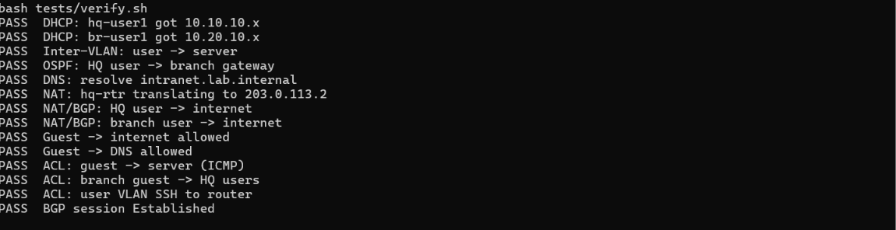
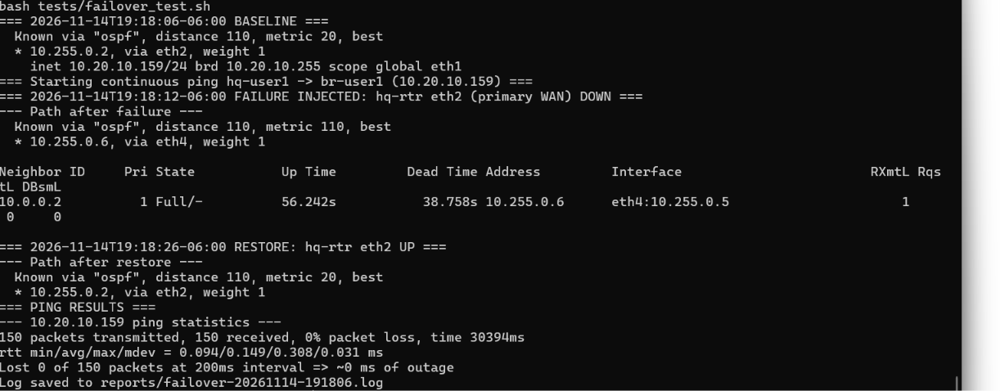

# Multi-Site Enterprise Network Lab

A simulated company network with a headquarters, a branch office and an ISP, built with **Containerlab + FRRouting**. It's configured the way a production network would be, automated with Python, monitored with Prometheus/Grafana, and failure-tested with a written incident report.

See the topology diagram in [docs/architecture.md](docs/architecture.md). GitHub renders the Mermaid diagram automatically.

## What's inside
| Area | Implementation |
|---|---|
| Sites | HQ (router + switch + 3 hosts), Branch (router + switch + 2 hosts), ISP |
| VLANs | 10 Users · 20 Servers · 30 Guest · 99 Mgmt, router-on-a-stick inter-VLAN routing |
| Routing | OSPF area 0 over dual WAN links (cost 10/100 + BFD), eBGP to ISP (AS 65001 ↔ 65000), default route redistributed |
| NAT | PAT on hq-rtr to 203.0.113.2, prefix-list blocks RFC1918 leaks |
| Services | DHCP per site (dnsmasq), central DNS `lab.internal` on hq-srv1 |
| Security | Guest isolation ACL, SSH-only management from MGMT VLANs, logged denies |
| Automation | `backup_configs.py` (configs → Git), `health_check.py` (Markdown report), Netmiko over SSH |
| Monitoring | Prometheus exporter → Grafana dashboard (OSPF/BGP/RTT/link state), Loki for logs |
| Failure test | `failover_test.sh` cuts the primary WAN, measures reroute → [incident report](docs/incident-report-wan-failover.md) |

Docs: [Architecture](docs/architecture.md) · [IP plan](docs/ip-plan.md) · [Incident report](docs/incident-report-wan-failover.md)

## Requirements
- Linux, or Windows with WSL2 (Ubuntu), with at least 4 GB RAM
- Docker, [Containerlab](https://containerlab.dev/install/), Python 3.10+
- Internet access on first deploy (containers `apk add` iptables/dnsmasq/openssh)

## Quick start
```bash
git clone https://github.com/<you>/enterprise-netlab && cd enterprise-netlab
make deploy                       # build the network (~1 min)
make verify                       # 14 functional checks: DHCP, DNS, OSPF, NAT, ACLs
pip install -r automation/requirements.txt
export NETADMIN_PASS='Lab@dmin123'
make health                       # writes reports/health-*.md
make backup                       # saves configs to backups/ and commits
make exporter &                   # metrics on :9105
make monitor                      # Grafana at http://localhost:3000
make failover                     # break the WAN and watch it reroute
```

## Useful commands
```bash
docker exec -it clab-netlab-hq-rtr vtysh          # router CLI
  show ip ospf neighbor
  show bgp summary
  show ip route
docker exec -it clab-netlab-hq-user1 sh            # be a user
docker exec clab-netlab-hq-rtr iptables -L GUEST-ACL -v -n   # ACL hit counters
```

## Results
**All 14 functional checks pass** (`make verify`):



**WAN failover: 0 packets lost.** The primary HQ↔Branch link was cut during a continuous ping (150 packets, 200 ms apart). OSPF moved traffic to the backup link (metric 20 → 110) and moved it back when the link was restored. Full write-up: [incident report](docs/incident-report-wan-failover.md).



## Skills demonstrated
OSPF design & path selection · BGP with prefix filtering · NAT/PAT · 802.1Q VLANs · DHCP/DNS · ACLs & management-plane hardening · Python network automation (Netmiko) · config management in Git · Prometheus/Grafana observability · failure testing & incident writing
