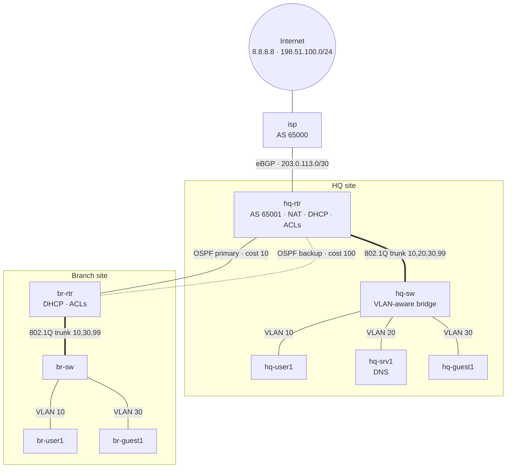

# Architecture

## Design decisions

**Routing.** OSPF area 0 joins the two sites over two WAN links. The primary has cost 10 and the backup cost 100, so traffic only uses the backup when the primary fails. BFD runs on both links so failures are detected in under a second instead of waiting out the 40 s OSPF dead timer. hq-rtr runs eBGP to the ISP, accepts only a default route plus the ISP's prefixes, and advertises nothing. It then injects the default into OSPF (`default-information originate`), so the branch reaches the internet through HQ (a centralized internet breakout).

**NAT.** All 10.0.0.0/8 traffic leaving eth1 is masqueraded to 203.0.113.2. The `TO-ISP` prefix-list denying everything is a second layer of protection, so private routes can never leak to the ISP.

**Switching.** Each switch is a VLAN-filtering Linux bridge with one trunk port up to the router and untagged access ports to hosts. Inter-VLAN routing is router-on-a-stick using 802.1Q sub-interfaces.

**Services.** Each site router runs DHCP locally (dnsmasq), so the branch keeps handing out leases even if the WAN is down. DNS is centralized on hq-srv1 for `lab.internal` and forwards everything else upstream.

**Security.**
- `GUEST-ACL`: guests can reach DNS on hq-srv1 and the internet. All other 10.0.0.0/8 traffic is logged as `GUEST-DENY` and dropped.
- `MGMT-IN`: SSH is accepted only from the MGMT VLANs (10.10.99.0/24, 10.20.99.0/24) and the automation network. Everything else is logged as `SSH-DENY`. Telnet and the FRR vty ports are blocked, and root login is disabled.

**Automation & monitoring.** Python (Netmiko) logs into the routers over SSH as `netadmin`, like it would on real gear. The exporter publishes OSPF, BGP, RTT and link state to Prometheus, and Grafana graphs them.

## What I'd change in production
- Add a second internet circuit or ISP at the branch, then make HQ and the branch iBGP peers
- Replace the shared password with SSH keys and TACACS+/RADIUS
- Use stateful firewall zones instead of iptables chains
- Run a DHCP relay to a central IPAM instead of per-site pools
