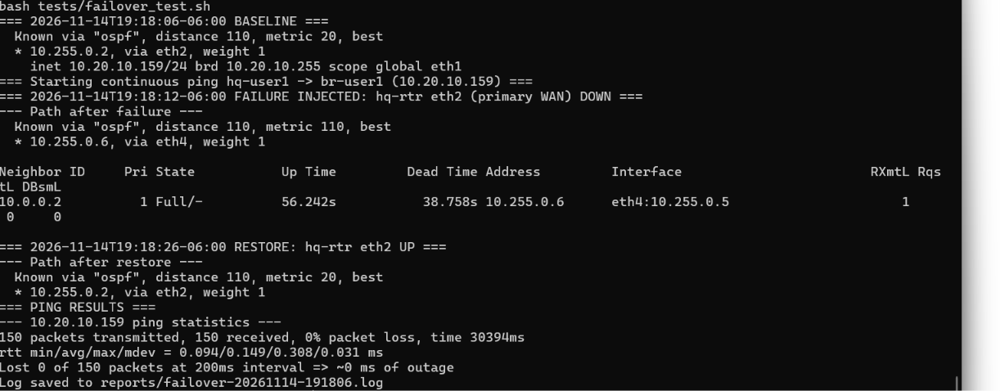

# Incident Report: Primary WAN Link Failure (HQ ↔ Branch)

| Field | Value |
|---|---|
| Incident ID | NETLAB-001 |
| Date | 2026-11-14 |
| Severity | SEV-3 (redundancy lost, no user-facing outage) |
| Duration | 14 seconds (19:18:12 → 19:18:26 CST) |
| Detected by | OSPF neighbor loss on hq-rtr eth2, route change to the backup link |
| User impact | **None.** 0 of 150 packets lost |
| Author | Joseph |

## Summary
The primary WAN link between hq-rtr (eth2) and br-rtr (eth1) was taken down in a controlled test. OSPF immediately moved HQ↔Branch traffic to the backup link (10.255.0.4/30). A continuous ping from hq-user1 to br-user1 (10.20.10.159) every 200 ms ran through the failure and the restore and **lost no packets**. When the link came back, traffic returned to the primary path on its own.

## Timeline (CST)
| Time | Event |
|---|---|
| 19:18:06 | Baseline: 10.20.10.0/24 reached via 10.255.0.2 on eth2 (primary), OSPF metric 20 |
| 19:18:06 | Continuous ping started: hq-user1 → br-user1, 150 packets at 200 ms |
| 19:18:12 | **Failure injected:** `ip link set eth2 down` on hq-rtr |
| ~19:18:12 | OSPF removed the primary path. Route now via 10.255.0.6 on eth4 (backup), metric 110 |
| 19:18:15 | Verified: only OSPF neighbor is 10.0.0.2 on eth4, state Full |
| 19:18:26 | **Restored:** `ip link set eth2 up` |
| 19:18:36 | Ping finished: 150/150 received. Route back on eth2, metric 20 |

## Impact
- Packets lost: **0 / 150** (0% loss). RTT stayed between 0.094 and 0.308 ms
- Services affected: none
- Branch internet access follows the same HQ path, so it was not interrupted either

## Root cause
Simulated: an administrator shut the interface down. In production this would be a carrier circuit failure.

## Analysis: why zero loss?
The failure was a **local link-down** on hq-rtr. The kernel removed the connected route immediately, and zebra/OSPF switched to the backup path within milliseconds, without waiting for any timer. A real circuit often fails *silently*: the port stays up, but the provider stops passing traffic. Then the router has to *detect* the failure:

| Detection method | Expected outage |
|---|---|
| Link-down (this test) | ~0 ms |
| BFD (configured: `ip ospf bfd`) | < 1 s |
| OSPF dead timer alone | up to 40 s |

So this result is the best case. The design is only proven against silent failures once the next test below is done.

## What went well
- The backup link was already a Full OSPF adjacency, so failover needed no manual action
- Cost-based path selection (10 vs 100) brought traffic back to the primary automatically
- The automated test script made the result repeatable, timestamped and logged

## Follow-up actions
| # | Action | Why |
|---|---|---|
| 1 | Repeat the test as a silent failure: drop traffic with `iptables`/`tc` while keeping the link up | Measures BFD detection time realistically |
| 2 | Run it again without `ip ospf bfd` and compare | Shows the value BFD adds |
| 3 | Add a Grafana alert on `netlab_wan_link_up == 0` | Someone gets notified, even when users feel nothing |

## Evidence
- Log: `reports/failover-20261114-191806.log`
- Screenshot: `docs/img/failover-test.png`
